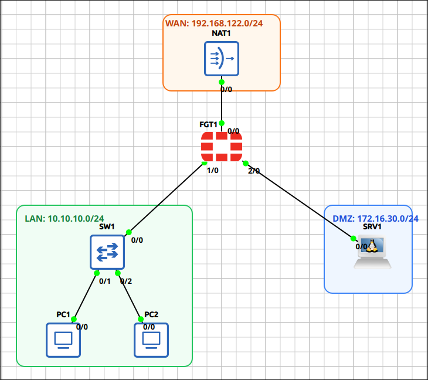
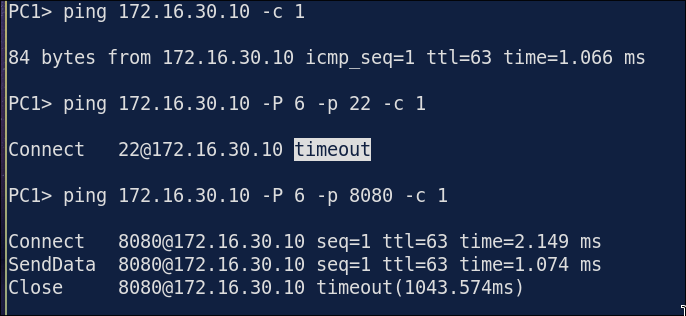
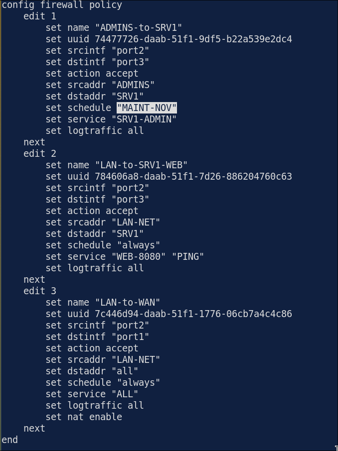
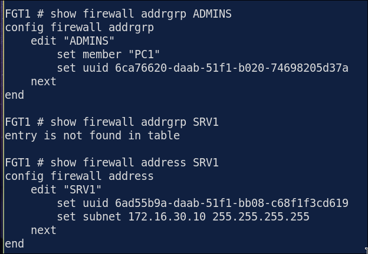
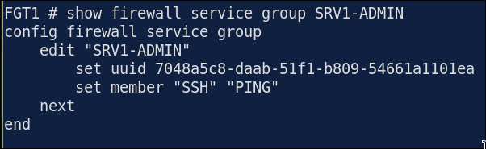
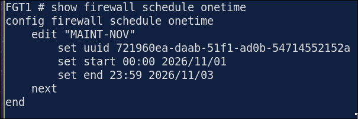
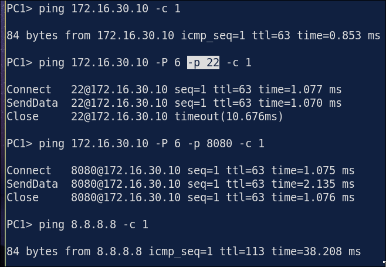
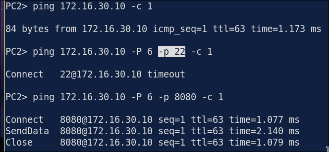
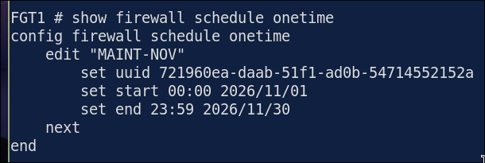

# Lab 1.2: Troubleshooting an Expired One-Time Schedule

> **GNS3 Project:** [`Fortigate Module 1 - Fundamentals | Lab 2 - Address Objects, Service Objects and Schedules.gns3`](./Fortigate%20Module%201%20-%20Fundamentals%20%7C%20Lab%202%20-%20Address%20Objects%2C%20Service%20Objects%20and%20Schedules.gns3)
> **Platform:** GNS3 3.1 · FortiGate-VM `8.0.1` (QEMU, evaluation license) · 1 firewall, 1 unmanaged switch, 2 VPCS hosts (PC1, PC2), 1 Alpine Linux server (SRV1), 1 NAT cloud
> **Key takeaway:** A policy matches on the schedule as well as on interfaces, addresses and service. When a one-time schedule expires, FortiOS gives no error: the policy silently stops matching and the traffic falls to the implicit deny.

---

## Topology & Addressing

| Device | Interface | Address | Role |
| :--- | :--- | :--- | :--- |
| **FGT1** | `port1` | 192.168.122.10/24, default route → 192.168.122.1 | WAN (NAT1) |
| **FGT1** | `port2` | 10.10.10.1/24 | LAN |
| **FGT1** | `port3` | 172.16.30.1/24 | DMZ |
| **PC1** | `e0` | 10.10.10.11/24, gw .1 | Admin PC (address group `ADMINS`) |
| **PC2** | `e0` | 10.10.10.12/24, gw .1 | User PC |
| **SRV1** | `eth0` | 172.16.30.10/24, gw .1 | DMZ server: SSH (22), web (8080) |

**Objects:** addresses `LAN-NET`, `PC1`, `PC2`, `SRV1` · address group `ADMINS` = `PC1` · custom service `WEB-8080` (tcp/8080) · service group `SRV1-ADMIN` = `SSH` + `PING` · one-time schedule `MAINT-NOV` (all of November).

| # | Policy | Source → Destination | Service | Schedule |
| :-: | :--- | :--- | :--- | :--- |
| 1 | `ADMINS-to-SRV1` | `ADMINS` → `SRV1` | `SRV1-ADMIN` | `MAINT-NOV` |
| 2 | `LAN-to-SRV1-WEB` | `LAN-NET` → `SRV1` | `WEB-8080`, `PING` | `always` |
| 3 | `LAN-to-WAN` | `LAN-NET` → `all` (NAT) | `ALL` | `always` |

**Design:** only PC1 may SSH to SRV1. Every LAN host may ping SRV1, open its web page on 8080 and reach the Internet.

---

## Fault-Injection (Break-It)

### Symptom
PC1 can no longer SSH to SRV1 (`ping 172.16.30.10 -P 6 -p 22` times out). Ping and the web page on 8080 still work, and nobody changed the policies.

### Diagnosis

1. **Which policy carries SSH?** Ping and 8080 still work because policy 2 allows them for the whole LAN. That hides the problem. SSH is only in policy 1 (`SRV1-ADMIN`), so policy 1 is the one that stopped matching.
   ~~~fortios
   show firewall policy
   ~~~
   

2. **Are the objects in policy 1 still right?** `ADMINS` still contains `PC1`, `SRV1` is still `172.16.30.10/32` and `SRV1-ADMIN` is still `SSH` + `PING`. A return policy isn't needed either: FortiGate is stateful, so replies use the same session.
   ~~~fortios
   show firewall addrgrp ADMINS
   show firewall address SRV1
   show firewall service group SRV1-ADMIN
   ~~~
   
   

3. **Is the schedule still active?** Policy 1 uses `MAINT-NOV`. Its end date is **3 Nov 2026**, but today is 7 Nov. The window was meant to run all of November, so the end date was a typo. The schedule has expired, so policy 1 never matches and SSH falls through to the implicit deny (policy 0).
   ~~~fortios
   show firewall schedule onetime
   ~~~
   

> **Wrong fix I tried first:** adding `SSH` to policy 2. PC1 could SSH again, but policy 2's source is `LAN-NET`, so **PC2 got SSH too**, which breaks the design. Always check the source of a policy before you add a service to it.

> **Cisco → FortiOS:** a time-based ACL (`time-range` + `periodic`/`absolute`) = a FortiOS schedule (`recurring`/`onetime`). An `absolute end` that has passed works the same way: the ACE goes inactive without any error.

### Fix
Fix the end date of the schedule, and take `SSH` back out of policy 2.
~~~fortios
config firewall schedule onetime
  edit MAINT-NOV
    set end 23:59 2026/11/30
  next
end
config firewall policy
  edit 2
    set service PING WEB-8080
  next
end
~~~

### Verification

| Test | Expected |
| :--- | :---: |
| `show firewall schedule onetime` | `set end 23:59 2026/11/30` |
| PC1 → SRV1 `ping 172.16.30.10 -P 6 -p 22` | Connect (allowed by policy 1) |
| PC2 → SRV1 `ping 172.16.30.10 -P 6 -p 22` | Timeout (no SSH for users) |
| PC1 / PC2 → SRV1 ping and `-P 6 -p 8080` | Reply / Connect (policy 2) |
| PC1 → 8.8.8.8 | Reply (policy 3, NAT) |

---

## Troubleshooting Toolbox (FortiOS)

| Command | What it shows |
| :--- | :--- |
| `show firewall policy` | Each policy's interfaces, addresses, services and **schedule** |
| `show firewall schedule onetime` / `recurring` | Start/end dates and days of each schedule |
| `show firewall address` / `addrgrp` / `service custom` / `service group` | What the objects actually contain |
| `diagnose firewall iprope list 100004` | The policies as the kernel compiled them, with the object values and schedule |
| `diagnose debug flow filter addr <ip>` → `diagnose debug flow trace start 10` → `diagnose debug enable` | Which policy a packet matches or is denied by |
