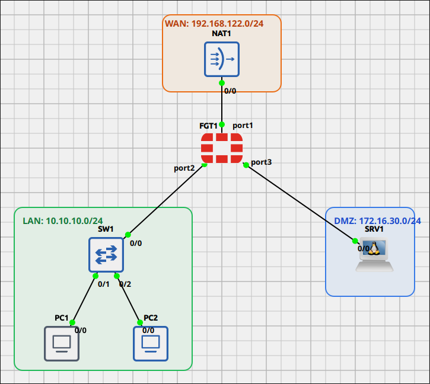
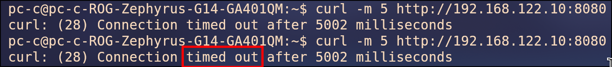
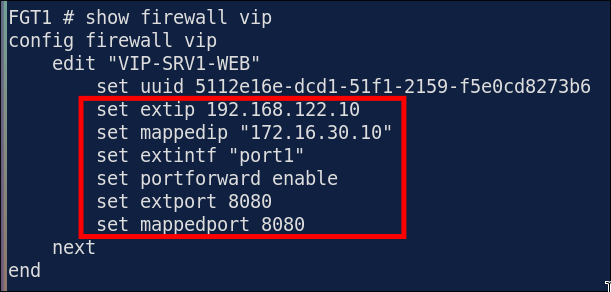
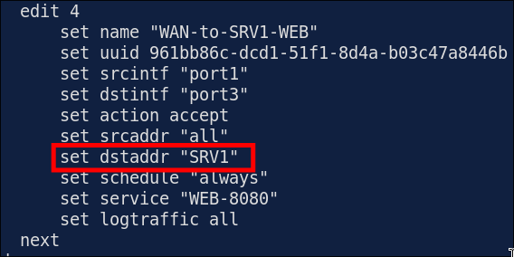
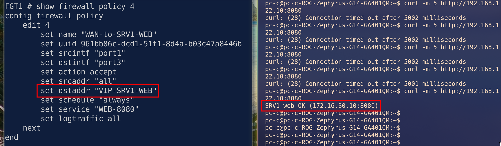
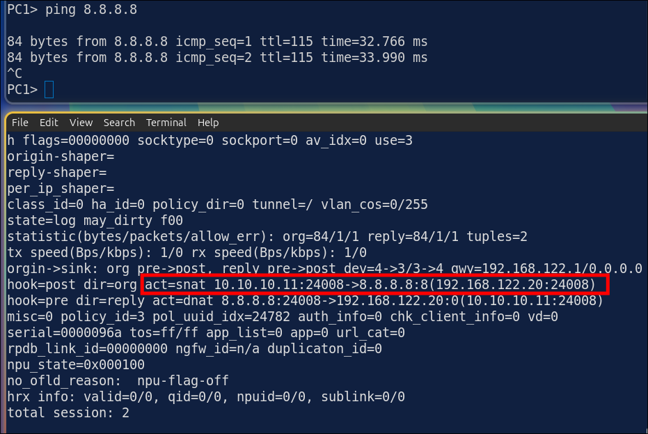
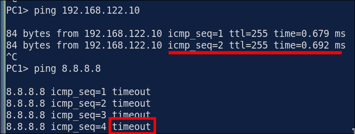
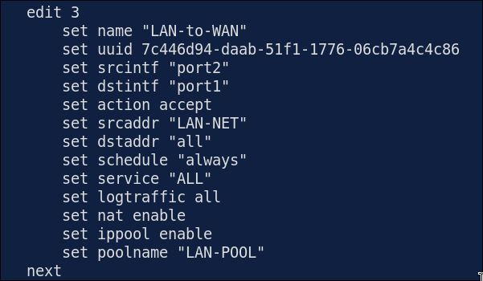
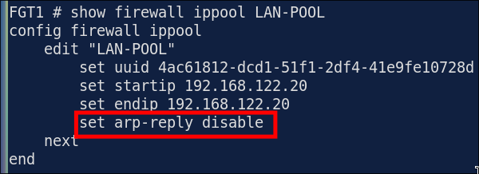
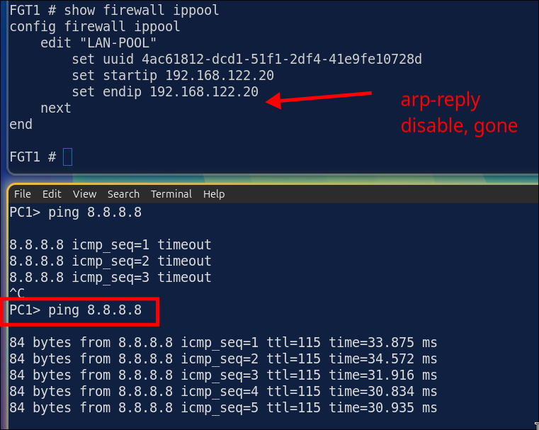

# Lab 1.3: Troubleshooting Destination and Source NAT (VIP and IP Pool)

> **GNS3 Project:** [`Fortigate Module 1 - Fundamentals | Lab 3 - Source NAT and Virtual IPs.gns3`](./Fortigate%20Module%201%20-%20Fundamentals%20%7C%20Lab%203%20-%20Source%20NAT%20and%20Virtual%20IPs.gns3)
> **Platform:** GNS3 3.1 · FortiGate-VM `8.0.1` (QEMU, evaluation license, max 3 policies) · 1 firewall, 1 unmanaged switch, 2 VPCS hosts (PC1, PC2), 1 Alpine Linux server (SRV1), 1 NAT cloud
> **Key takeaway:** With policy-based NAT, a VIP only takes effect when a policy uses the **VIP object** as its `dstaddr`. If the policy names the server's real address, the packet is never translated: it stays addressed to FGT1's own WAN IP and is dropped. An IP pool address is not an interface IP, so the upstream router only finds it through ARP. If the pool has `arp-reply disable`, outbound NAT works but the replies never come back.

---

## Topology & Addressing

| Device | Interface | Address | Role |
| :--- | :--- | :--- | :--- |
| **FGT1** | `port1` | 192.168.122.10/24, default route → 192.168.122.1 | WAN (NAT1) |
| **FGT1** | `port2` | 10.10.10.1/24 | LAN |
| **FGT1** | `port3` | 172.16.30.1/24 | DMZ |
| **PC1** | `e0` | 10.10.10.11/24, gw .1 | User PC |
| **PC2** | `e0` | 10.10.10.12/24, gw .1 | User PC |
| **SRV1** | `eth0` | 172.16.30.10/24, gw .1 | DMZ web server (tcp/8080) |
| **Host PC** | `virbr0` | 192.168.122.1/24 | "Internet" client (behind NAT1) |

**NAT objects:** IP pool `LAN-POOL` = 192.168.122.20 (overload) · VIP `VIP-SRV1-WEB` = `port1` 192.168.122.10:8080 → 172.16.30.10:8080.

| # | Policy | Interfaces | Source → Destination | Service | NAT |
| :-: | :--- | :--- | :--- | :--- | :--- |
| 2 | `LAN-to-SRV1-WEB` | port2 → port3 | `LAN-NET` → `SRV1` | `PING`, `WEB-8080` | — |
| 3 | `LAN-to-WAN` | port2 → port1 | `LAN-NET` → `all` | `ALL` | SNAT to `LAN-POOL` |
| 4 | `WAN-to-SRV1-WEB` | port1 → port3 | `all` → `VIP-SRV1-WEB` | `WEB-8080` | DNAT by the VIP |

**Design:** the LAN goes out to the Internet as 192.168.122.20. Outside clients reach the SRV1 website at 192.168.122.10:8080.

---

## Fault 1 (Break-It): VIP Not Used by the Policy

### Symptom
From the host PC, `curl -m 5 http://192.168.122.10:8080` times out. Inside the LAN, PC1 still opens the site directly (`ping 172.16.30.10 -P 6 -p 8080` connects) and still reaches the Internet.

### Diagnosis

1. **Is the VIP mapping right?** Check this first, because nothing after it can work if the translation is wrong. `VIP-SRV1-WEB` maps `port1` 192.168.122.10:8080 → 172.16.30.10:8080, which matches the design.
   ~~~fortios
   show firewall vip
   ~~~
   

2. **Does the inbound policy use the VIP?** Policy 4 has `dstaddr "SRV1"`, the server's **real** address. The client sends to 192.168.122.10, so with no VIP in the policy FortiGate never translates the packet. It is addressed to FGT1 itself and gets dropped.
   ~~~fortios
   show firewall policy 4
   ~~~
   

> **Why `dstintf` is port3 and not port1:** FortiGate applies the VIP (DNAT) first, then does the route lookup on the *mapped* address. 172.16.30.10 is reached through port3, so the policy is port1 → port3.

> **Cisco → FortiOS:** `ip nat inside source static tcp 172.16.30.10 8080 192.168.122.10 8080` = a VIP with `portforward enable`. The difference is that on FortiGate the VIP also has to be named in a firewall policy.

### Fix
~~~fortios
config firewall policy
  edit 4
    set dstaddr "VIP-SRV1-WEB"
  next
end
~~~

### Verification

| Test | Expected |
| :--- | :---: |
| `show firewall policy 4` | `set dstaddr "VIP-SRV1-WEB"` |
| Host PC `curl -m 5 http://192.168.122.10:8080` | `SRV1 web OK (172.16.30.10:8080)` |
| PC1 / PC2 `ping 8.8.8.8` | Reply (policy 3) |
| `diagnose sys session list` (filter `dst 8.8.8.8`) | `act=snat 10.10.10.11 → 192.168.122.20` |

---

## Fault 2 (Break-It): IP Pool Doesn't Answer ARP

### Symptom
PC1 and PC2 can't reach the Internet (`ping 8.8.8.8` times out), but they can still ping FGT1's `port1` (192.168.122.10). FGT1's own `execute ping 8.8.8.8` gets replies, and the website through the VIP still works from the host PC.

### Diagnosis

1. **What's different about FGT1's own ping?** FGT1 pings from its interface IP, 192.168.122.10. LAN traffic is translated to the pool address, 192.168.122.20. The WAN path works, so the problem is in the source NAT.

2. **Is policy 3 still doing SNAT?** Policy 3 still has `nat enable` + `ippool enable` + `poolname "LAN-POOL"`, so the policy is fine.
   ~~~fortios
   show firewall policy 3
   ~~~
   

3. **Is the pool right?** The address is still 192.168.122.20, but the pool has `set arp-reply disable`. NAT1 sends the reply to .20 and first ARPs "who has 192.168.122.20?". Nobody answers, so the reply is never delivered.
   ~~~fortios
   show firewall ippool
   ~~~
   

> **Cisco → FortiOS:** on Cisco, the router answers ARP for NAT pool addresses on its own. On FortiGate this is the IP pool setting `arp-reply` (default `enable`). Turn it off only when the upstream router has a route for the pool pointing at the firewall.

### Fix
~~~fortios
config firewall ippool
  edit "LAN-POOL"
    set arp-reply enable
  next
end
~~~

### Verification

| Test | Expected |
| :--- | :---: |
| `show firewall ippool` | No `arp-reply disable` line (default is enable) |
| PC1 / PC2 `ping 8.8.8.8` | Reply |
| Host PC `ip neigh show 192.168.122.20` | FGT1's port1 MAC, `REACHABLE` |
| Host PC `curl -m 5 http://192.168.122.10:8080` | Still `SRV1 web OK` |

---

## Troubleshooting Toolbox (FortiOS)

| Command | What it shows |
| :--- | :--- |
| `show firewall vip` | External IP/port, mapped IP/port and the interface of each VIP |
| `show firewall policy` | Whether the inbound policy's `dstaddr` is the **VIP**, not the real IP |
| `show firewall ippool` | The SNAT pool addresses, type and `arp-reply` |
| `execute ping 8.8.8.8` | Whether the firewall's own WAN path works (sourced from the interface IP, not the pool) |
| `diagnose sniffer packet port1 'icmp or arp' 4` | Packets leaving with the pool IP, and ARP requests for it that go unanswered |
| `diagnose sys session filter dst <ip>` → `diagnose sys session list` | `act=snat` / `act=dnat` and the translated addresses of each session |
| `diagnose debug flow filter addr <ip>` → `diagnose debug flow trace start 10` → `diagnose debug enable` | Whether a VIP matched and which policy allowed or denied the packet |
