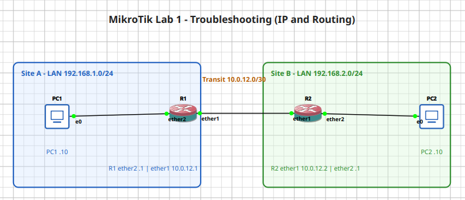
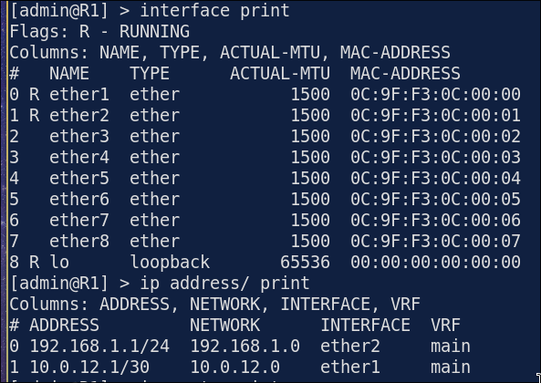
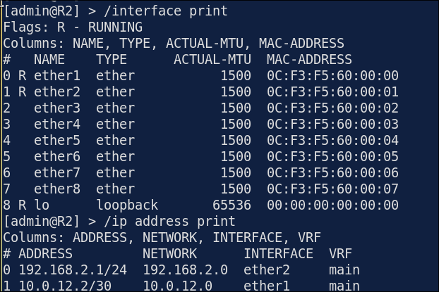
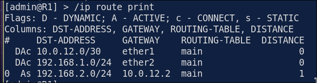
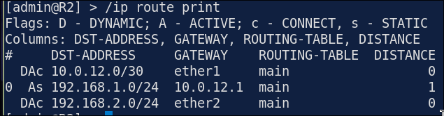
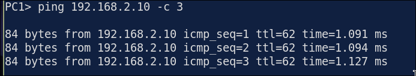
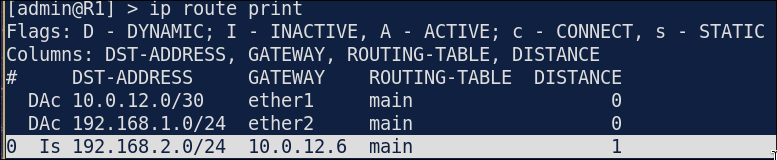
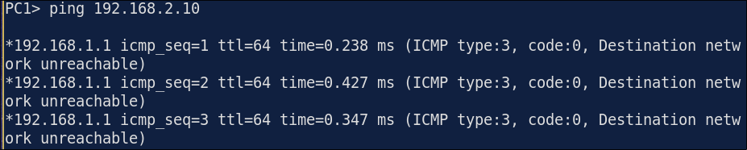
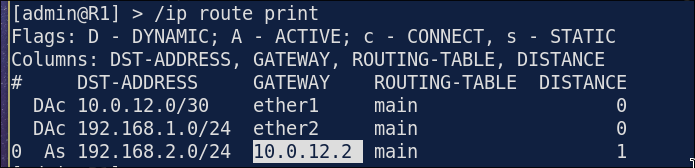
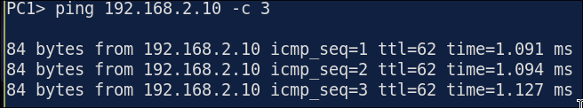

# Lab 1.1: Troubleshooting IP Addressing & Static Routing

> **GNS3 Project:** [`MikroTik Module 1 - Fundamentals | Lab 1 - Troubleshooting IP Addressing and Static Routing.gns3`](./MikroTik%20Module%201%20-%20Fundamentals%20%7C%20Lab%201%20-%20Troubleshooting%20IP%20Addressing%20and%20Static%20Routing.gns3)
> **Platform:** GNS3 3.1 · MikroTik CHR RouterOS `7.22.1` (QEMU, `chr-7.22.1.img`) · 2 routers (R1, R2), 2 VPCS hosts (PC1, PC2)
> **Key takeaway:** RouterOS marks a static route `I` (inactive) when its gateway is not reachable through a connected network, and the route is then not used for forwarding. In `/ip route print`, the `A` flag is the first thing to check.

---

## 1. Scenario & Tasks

Two small sites, each behind a MikroTik CHR router, are joined by a `/30` transit link. PC1 in Site A must reach PC2 in Site B using static routes only.

The lab was run as a **fault-injection exercise**: the network was built with one hidden mistake, and I was given only the symptom (_PC1 cannot ping PC2_).

- **Task 1 — Interfaces and IP addressing:** Set the hostnames, remove the default DHCP client, and add IP addresses to `ether1` (transit) and `ether2` (LAN) on both routers.
- **Task 2 — Static routing:** On each router, add a static route to the remote LAN using the neighbour's transit address as the gateway.
- **Task 3 — End hosts and testing:** Configure PC1 and PC2, then prove end-to-end reachability with `ping` and `trace`.

### IPv4 Addressing

| Device | Interface | Address | Gateway |
| :--- | :--- | :--- | :--- |
| **R1** | `ether1` | 10.0.12.1/30 | — |
| **R1** | `ether2` | 192.168.1.1/24 | — |
| **R2** | `ether1` | 10.0.12.2/30 | — |
| **R2** | `ether2` | 192.168.2.1/24 | — |
| **PC1** | `e0` | 192.168.1.10/24 | 192.168.1.1 |
| **PC2** | `e0` | 192.168.2.10/24 | 192.168.2.1 |

### Cabling

| From | To |
| :--- | :--- |
| PC1 `e0` | R1 `ether2` |
| R1 `ether1` | R2 `ether1` |
| R2 `ether2` | PC2 `e0` |

### Access

| Item | Value |
| :--- | :--- |
| Console | Telnet from GNS3 (R1 `5007`, R2 `5004`) |
| Login | `admin` / `admin` (lab only; CHR asks for a new password on first login, `Ctrl-C` skips it) |

---

## 2. Configuration & Verification

### Task 1: Interfaces and IP Addressing

**R1:**
~~~routeros
/system identity set name=R1
/ip dhcp-client remove [find]
/ip address add address=192.168.1.1/24 interface=ether2
/ip address add address=10.0.12.1/30 interface=ether1
~~~

**R2:**
~~~routeros
/system identity set name=R2
/ip dhcp-client remove [find]
/ip address add address=192.168.2.1/24 interface=ether2
/ip address add address=10.0.12.2/30 interface=ether1
~~~

* **`/interface print`:** `ether1` and `ether2` have the `R` (running) flag, so the links are up.
* **`/ip address print`:** each router has one address on `ether1` and one on `ether2`, with the correct network.

---

### Task 2: Static Routing

**R1:**
~~~routeros
/ip route add dst-address=192.168.2.0/24 gateway=10.0.12.2
~~~

**R2:**
~~~routeros
/ip route add dst-address=192.168.1.0/24 gateway=10.0.12.1
~~~

* **`/ip route print`:** the static route is flagged `As` (active, static) on both routers. Connected networks show as `DAc` (dynamic, active, connected).

| Flag | Meaning |
| :---: | :--- |
| `A` | Active: the route is installed and used for forwarding |
| `I` | Inactive: the route exists but cannot be used (for example, gateway unreachable) |
| `D` | Dynamic: added automatically, not by the admin |
| `c` / `s` | Connected / Static |

---

### Task 3: End Hosts and Testing

**PC1 / PC2 (VPCS):**
~~~
PC1> ip 192.168.1.10/24 192.168.1.1
PC1> save
PC2> ip 192.168.2.10/24 192.168.2.1
PC2> save
~~~

---

## 3. Notes & Fault-Injection (Break-It)

### Fault-Injection: Wrong Next-Hop on R1's Static Route
* **Injected Fault:** R1's route to `192.168.2.0/24` was configured with gateway `10.0.12.6`, an address outside the `10.0.12.0/30` transit subnet.
  ~~~routeros
  /ip route add dst-address=192.168.2.0/24 gateway=10.0.12.6
  ~~~
* **Symptom:** PC1 can ping R1 and R2's transit address (`10.0.12.2`), but not PC2. R1 answers with **ICMP Destination network unreachable**, because it has no usable route to `192.168.2.0/24`.
* **Diagnosis:** In `/ip route print` on R1, the route is flagged `Is` (**inactive**, static) instead of `As`. `10.0.12.6` is not on any connected network, so RouterOS cannot resolve the next hop and does not install the route.
* **Why PC1 could still reach 10.0.12.2:** that network is directly connected on R1, and R2 already had a correct route back to `192.168.1.0/24`. Only the R1 → Site B direction was broken.

* **Fix:** Point the route at R2's real transit address. The route becomes `As` and the ping succeeds.
  ~~~routeros
  /ip route set [find dst-address=192.168.2.0/24] gateway=10.0.12.2
  ~~~

### Troubleshooting Toolbox (RouterOS)

| Command | What it shows |
| :--- | :--- |
| `/interface print` | Link state (`R` = running) |
| `/ip address print` | Addresses and the connected networks they create |
| `/ip route print` | Route table with `A` / `I` flags |
| `/ip route print detail where static` | Gateway and `immediate-gw` (next hop + exit interface) |
| `ping <ip>` | Reachability from the router itself |
