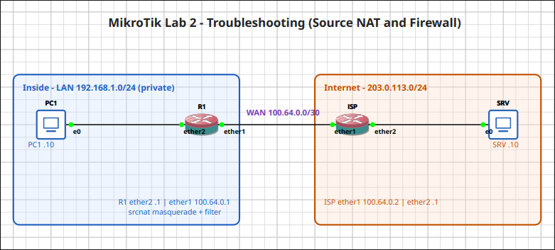
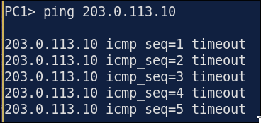
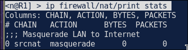
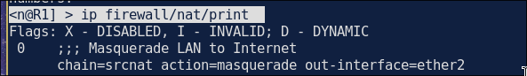
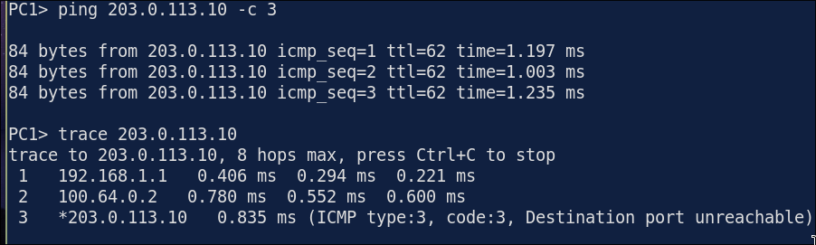

# Lab 1.2: Troubleshooting Source NAT (Masquerade)

> **GNS3 Project:** [`MikroTik Module 1 - Fundamentals | Lab 2 - Troubleshooting Source NAT and Firewall Filter.gns3`](./MikroTik%20Module%201%20-%20Fundamentals%20%7C%20Lab%202%20-%20Troubleshooting%20Source%20NAT%20and%20Firewall%20Filter.gns3)
> **Platform:** GNS3 3.1 · MikroTik CHR RouterOS `7.22.1` · 2 routers (R1, ISP), 2 VPCS hosts (PC1, SRV)
> **Key takeaway:** RouterOS has no `ip nat inside/outside`. The "outside" is the `out-interface` on the masquerade rule itself. If it names the wrong interface, the rule never matches and private addresses leak to the ISP.

---

## Topology & Addressing

| Device | Interface | Address | Role |
| :--- | :--- | :--- | :--- |
| **PC1** | `e0` | 192.168.1.10/24, gw .1 | Inside host |
| **R1** | `ether2` | 192.168.1.1/24 | LAN |
| **R1** | `ether1` | 100.64.0.1/30 | WAN; default route to 100.64.0.2 |
| **ISP** | `ether1` / `ether2` | 100.64.0.2/30 / 203.0.113.1/24 | "Internet". No route to 192.168.1.0/24 |
| **SRV** | `e0` | 203.0.113.10/24, gw .1 | Internet server |

R1 also runs a basic filter: `input` and `forward` accept established/related, drop invalid, allow LAN → WAN, drop the rest.

---

## Fault-Injection (Break-It)

### Symptom
PC1 cannot ping `203.0.113.10` (every request times out). R1 itself can ping SRV, and PC1 can ping both of R1's addresses.

### Diagnosis

1. **Is the NAT rule being hit?** `print stats` shows **0 packets** while PC1 is pinging, so nothing is being translated.
   ~~~routeros
   /ip firewall nat print stats
   ~~~
   

2. **What does the rule match?** `print` (without `stats`) shows the matchers. The rule uses `out-interface=ether2`, which is the **LAN** side, not the WAN.
   ~~~routeros
   /ip firewall nat print
   ~~~
   

3. **Why it times out:** PC1's packet leaves `ether1` with its private source `192.168.1.10`. SRV replies to `192.168.1.10`, but the ISP has no route back to it, so the reply is dropped.

> **Cisco → RouterOS:** `ip nat inside/outside` = the rule's `in-interface` / `out-interface`. `overload` (PAT) = `action=masquerade`. `print stats` shows counters only; use `print` to see the matchers.

### Fix
Edit the existing rule; don't add a second one.
~~~routeros
/ip firewall nat set 0 out-interface=ether1 in-interface=ether2
~~~

### Verification

| Test | Expected |
| :--- | :---: | 
| `/ip firewall nat print stats` | Packet counter increasing | 
| PC1 → 203.0.113.10 | Reply | 
| `trace` PC1 → SRV | 192.168.1.1 → 100.64.0.2 → 203.0.113.10 | 
| `/tool sniffer quick interface=ether1 ip-protocol=icmp` | Source `100.64.0.1`, not `192.168.1.10` | 

---

## Troubleshooting Toolbox (RouterOS)

| Command | What it shows |
| :--- | :--- |
| `/ip firewall nat print` | NAT rules with their matchers (`out-interface`, `src-address`) |
| `/ip firewall nat print stats` | Bytes/packets per rule: is it matching at all? |
| `/ip firewall filter print stats` | Which filter rule is dropping (rules out the firewall) |
| `/ip firewall connection print where src-address~"192.168.1.10"` | Connection tracking entries and translated reply address |
| `/tool sniffer quick interface=ether1 ip-protocol=icmp` | Source IP actually leaving the WAN |
