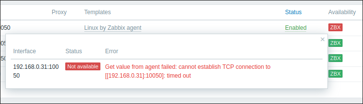
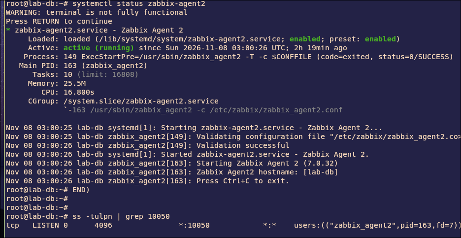
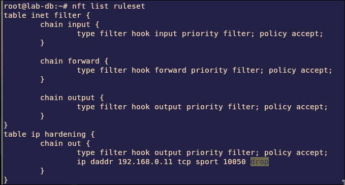
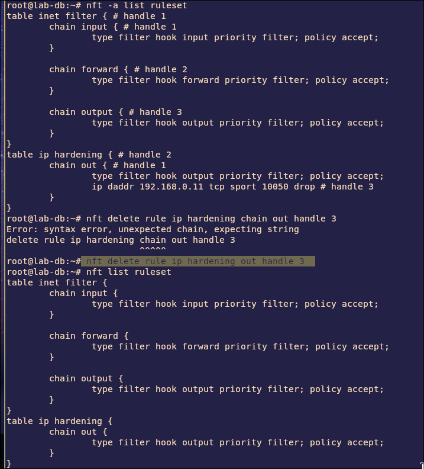
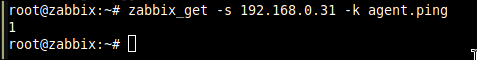
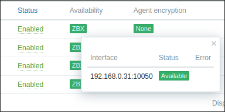

# Lab 1.1: Troubleshooting Zabbix Agent Availability (Firewall)

> **Platform:** Proxmox VE · LXC containers (Debian 12) · Zabbix server `7.0` · `zabbix-agent2 7.0.32` · nftables
> **Key takeaway:** A **timeout** means packets are being silently dropped, which usually points to a firewall. Read the **whole** ruleset: the drop rule can sit in any table and in the **output** chain, not just input.

---

## Topology & Addressing

| Host | Address | Role |
| :--- | :--- | :--- |
| **zabbix-server** | 192.168.0.11 | Zabbix server + web UI (port 80) |
| **lab-web** | 192.168.0.30 | Monitored host, zabbix-agent2 |
| **lab-db** | 192.168.0.31 | Monitored host, zabbix-agent2, nftables |

Passive checks: the server connects to the agent on **TCP 10050**. The agent replies from source port 10050.

---

## Fault-Injection (Break-It)

### Symptom
**lab-db** turns red (ZBX icon) in **Data collection → Hosts**. lab-web is still green. The error:

~~~
Get value from agent failed: cannot establish TCP connection to [[192.168.0.31]:10050]: timed out
~~~

### Diagnosis

1. **Read the error type.** Each Zabbix agent error points to a different layer:

   | Error | Meaning | Usual cause |
   | :--- | :--- | :--- |
   | Connection **refused** | Nothing is listening on 10050 | Agent stopped, or wrong `ListenPort` |
   | **Empty response** / access permissions | Connected, then the agent dropped it | Server IP missing from `Server=` |
   | Connection **timed out** | Packets silently dropped | Firewall |

2. **Is the agent running and listening?** Yes, so the agent itself is fine.
   ~~~bash
   systemctl status zabbix-agent2
   ss -tlnp | grep 10050
   ~~~
   

3. **Check the firewall.** The `inet filter` table is empty, but a second table holds a drop rule in the **output** chain:
   ~~~bash
   nft list ruleset
   ~~~
   ~~~
   table ip hardening {
       chain out {
           type filter hook output priority filter; policy accept;
           ip daddr 192.168.0.11 tcp sport 10050 drop
       }
   }
   ~~~
   

4. **Why it times out:** the server's request reaches the agent, but the agent's **reply** to 192.168.0.11 is dropped on the way out. The server never gets an answer and gives up.

### Fix
Find the rule's handle, then delete it by handle. The handle number can differ on your system (here it was `3`). The chain name goes straight after the table name, with no `chain` keyword.
~~~bash
nft -a list ruleset
nft delete rule ip hardening out handle 3
~~~

> The rule was added at runtime. If a rule comes back after a reboot, check `/etc/nftables.conf` as well.

### Verification

| Test | Expected |
| :--- | :---: |
| `nft list ruleset` on lab-db | No drop rule for 10050 |
| `zabbix_get -s 192.168.0.31 -k agent.ping` (from server) | `1` |
| lab-db ZBX icon | Green |

---

## Troubleshooting Toolbox

| Command | What it shows |
| :--- | :--- |
| `tail /var/log/zabbix/zabbix_agent2.log` | Agent errors (e.g. rejected connections) |
| `ss -tlnp \| grep zabbix` | Is the agent listening, and on which port? |
| `nft list ruleset` | Every table and chain, including output |
| `nft -a list ruleset` | Same, with rule handles for `nft delete` |
| `zabbix_get -s <agent-ip> -k agent.ping` | Test the agent directly from the server |
