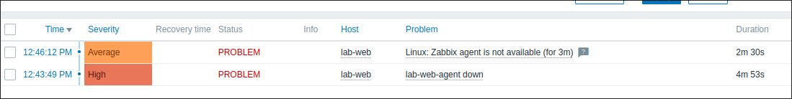
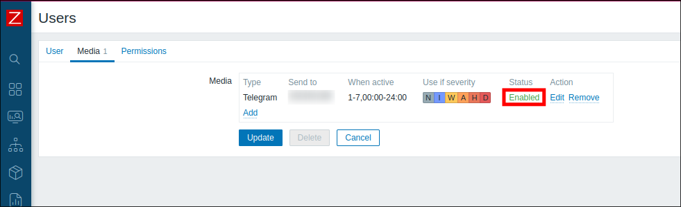
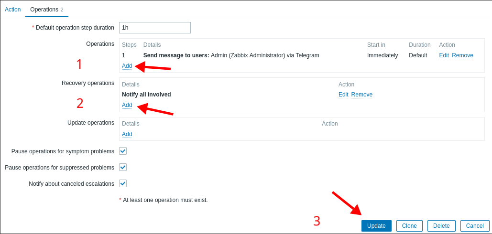
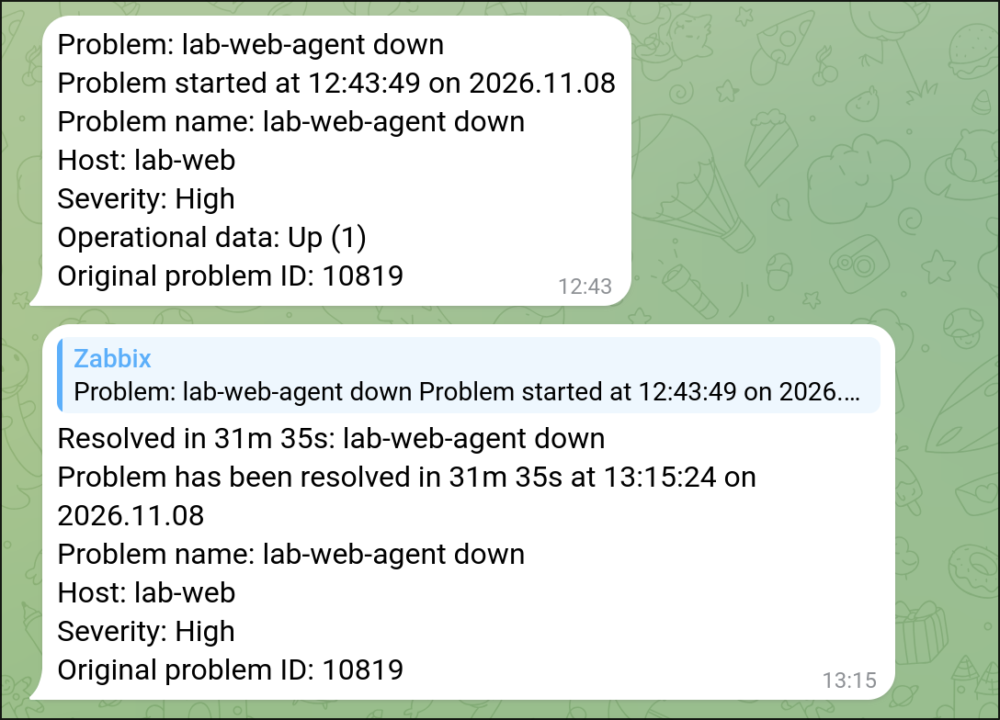
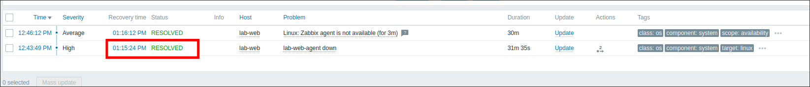

# Lab 1.2: Trigger and Telegram Alert

> **Platform:** Proxmox VE · LXC containers (Debian 12) · Zabbix server `7.0` · `zabbix-agent2 7.0.32` · Telegram bot (built-in webhook media type)
> **Key takeaway:** A firing trigger sends nothing on its own. Zabbix needs **three pieces**: a **media type** (how), **user media** (who), and an **action** (when). If one is missing, the problem appears in the UI but no message goes out.

---

## Topology & Addressing

| Host | Address | Role |
| :--- | :--- | :--- |
| **zabbix-server** | 192.168.0.11 | Zabbix server + web UI |
| **lab-web** | 192.168.0.30 | Monitored host, zabbix-agent2 |

### Trigger

| Field | Value |
| :--- | :--- |
| Name | `lab-web-agent down` |
| Expression | `nodata(/lab-web/agent.ping,3m)=1` |
| Severity | High |

`agent.ping` returns `1` while the agent is up and **nothing** when it is down, so the trigger tests for missing data, not for `0`. It fires about 3 minutes after the **last value received**, and it clears as soon as the next value arrives (about 1 minute).

---

## Fault-Injection (Break-It)

### Symptom
With the agent stopped on lab-web (`systemctl stop zabbix-agent2`), the problem `lab-web-agent down` shows in **Monitoring → Problems**, but **no Telegram message** arrives.

### Diagnosis

1. **Is the trigger working?** Yes. The problem is listed with severity High (next to the template's own "Zabbix agent is not available" problem, severity Average).

2. **Did Zabbix try to send anything?** Check **Reports → Action log** for the last 30 minutes. No entry means no action matched or there was no recipient.

3. **Check the three pieces:**

   | Piece | Where | State |
   | :--- | :--- | :---: |
   | Media type (bot token) | Alerts → Media types → Telegram | Set |
   | User media (chat ID) | Users → Users → Admin → Media | **Missing** |
   | Action (rule) | Alerts → Actions → Trigger actions | **Missing** |

### Fix

1. **Media type:** In **Alerts → Media types → Telegram**, set the `api_token` parameter to the bot token from @BotFather and tick **Enabled**.
2. **User media:** In **Users → Users → Admin → Media → Add**, set Type to `Telegram` and Send to to `<CHAT_ID>` (from @userinfobot). Then click **Update**. Send `/start` to the bot first, because a bot can't message you until you've messaged it.
3. **Action:** In **Alerts → Actions → Trigger actions → Create action**:
   - Condition: **Trigger severity ≥ High**
   - Operation: send to user **Admin** via **Telegram**
   - Recovery operation: **Notify all involved**

> Never commit the bot token or chat ID. Anyone with the token controls the bot.

### Verification

| Test | Expected |
| :--- | :---: |
| `systemctl stop zabbix-agent2` on lab-web, wait ~3 min | Telegram **Problem** message |
| `systemctl start zabbix-agent2` | Telegram **Resolved** message within ~1 min |
| Reports → Action log | Status **Sent** |
| Monitoring → Problems, Show: **History** | `lab-web-agent down` with status **RESOLVED** |

---

## Troubleshooting Toolbox

| Where / Command | What it shows |
| :--- | :--- |
| Monitoring → Problems (Show: Problems / History) | Did the trigger fire and resolve? |
| Reports → Action log | Was a message sent, and did it fail (with error text)? |
| Users → Users → Admin → Media | Is there a Telegram recipient, and is it enabled? |
| Alerts → Actions → Trigger actions | Is the action enabled, and do its conditions match? |
| `systemctl stop / start zabbix-agent2` | Fire and clear the trigger on demand |
