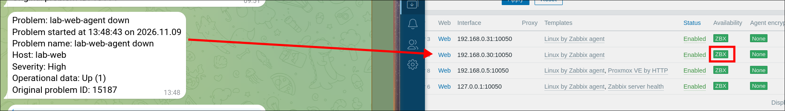
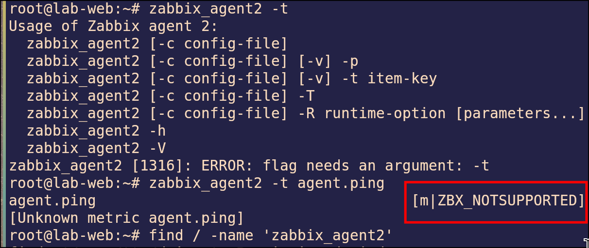
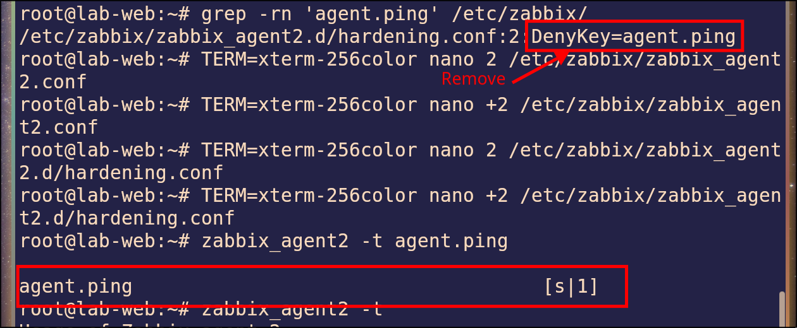
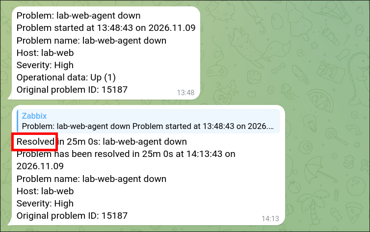

# Lab 1.3: Trigger Fires but Host Is Green (DenyKey)

> **Platform:** Proxmox VE · LXC containers (Debian 12) · Zabbix server `7.0` · `zabbix-agent2 7.0.32` · Telegram alerting from [Lab 1.2](../Lab%202%20%E2%80%93%20Trigger%20and%20Telegram%20Alert/README.md)
> **Key takeaway:** A green ZBX icon only means the agent **answers** on 10050. It doesn't mean every item **works**. A single key can be blocked with `DenyKey`, and only a trigger built on that **item** will notice.

---

## Topology & Addressing

| Host | Address | Role |
| :--- | :--- | :--- |
| **zabbix-server** | 192.168.0.11 | Zabbix server + web UI |
| **lab-web** | 192.168.0.30 | Monitored host, zabbix-agent2 |

| Trigger | Expression | Severity |
| :--- | :--- | :--- |
| `lab-web-agent down` (Lab 1.2) | `nodata(/lab-web/agent.ping,3m)=1` | High |
| Zabbix agent is not available (template) | `zabbix[host,agent,available]` | Average |

---

## Fault-Injection (Break-It)

### Symptom
A Telegram **Problem** message arrives for `lab-web-agent down`. But the agent service is running, ping to lab-web works, and lab-web's ZBX icon is **green**. The template's "Zabbix agent is not available" problem does **not** appear.

### Diagnosis

1. **Is the host reachable?** Yes. Ping works and the agent is `active (running)`.
   ~~~bash
   systemctl status zabbix-agent2
   ~~~

2. **Can the agent return the item?** Ask it directly on lab-web:
   ~~~bash
   zabbix_agent2 -t agent.ping
   ~~~
   ~~~
   agent.ping                                    [m|ZBX_NOTSUPPORTED] [Unknown metric agent.ping]
   ~~~
   The agent runs but refuses this one key. **Monitoring → Latest data** shows `agent.ping` as *Not supported*.

   

3. **Find the rule.** The main config is clean, but it includes `zabbix_agent2.d/*.conf`:
   ~~~bash
   grep -rn DenyKey /etc/zabbix/
   ~~~
   ~~~
   /etc/zabbix/zabbix_agent2.d/hardening.conf:2:DenyKey=agent.ping
   ~~~

4. **Why only one trigger fired:**

   | Trigger | Watches | During the fault | Fired? |
   | :--- | :--- | :--- | :---: |
   | `lab-web-agent down` | `agent.ping` **values** | No values (not supported) | **Yes** |
   | Template "agent not available" | Agent **answers** on 10050 | Agent still answers | No |

   When the agent is stopped (Lab 1.2), nothing answers, so **both** fire.

### Fix
Comment out the rule and restart the agent:
~~~bash
sed -i 's/^DenyKey=agent.ping/#DenyKey=agent.ping/' /etc/zabbix/zabbix_agent2.d/hardening.conf
systemctl restart zabbix-agent2
~~~

### Verification

| Test | Expected |
| :--- | :---: |
| `zabbix_agent2 -t agent.ping` on lab-web | `agent.ping [s\|1]` |
| Monitoring → Latest data → agent.ping | New values, no *Not supported* |
| Telegram | **Resolved** message |
| Monitoring → Problems, Show: **History** | `lab-web-agent down` **RESOLVED** |

---

## Troubleshooting Toolbox

| Command | What it shows |
| :--- | :--- |
| `zabbix_agent2 -t <key>` | Can the agent return this one item? |
| `grep -rn 'AllowKey\|DenyKey' /etc/zabbix/` | Key rules in the main config **and** include files |
| `systemctl status zabbix-agent2` | Is the agent running? |
| Monitoring → Latest data | Item state (*Not supported* with the error text) |
| `nc -zv -w3 <agent-ip> 10050` | Is the agent port open? (Here it was, so the network was fine.) |
