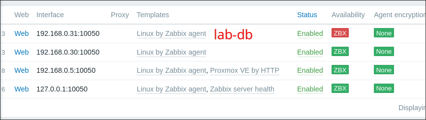
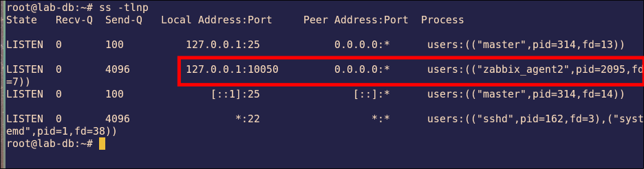
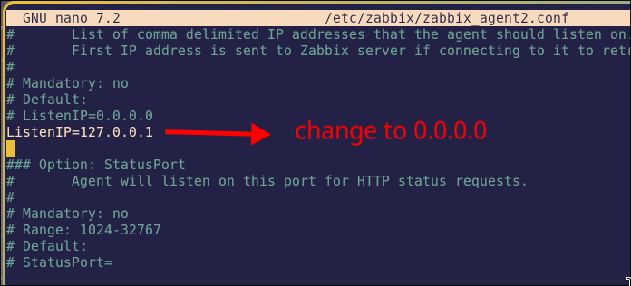
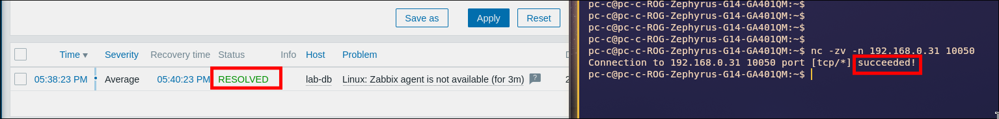

# Lab 1.4: Agent Listening Only on Localhost (ListenIP)

> **Platform:** Proxmox VE · LXC containers (Debian 12) · Zabbix server `7.0` · `zabbix-agent2 7.0.32`
> **Key takeaway:** *Connection refused* with the agent running and on the right port means it's listening on the wrong **address**. Ping proves only that the host is up. Test the **port** itself.

---

## Topology & Addressing

| Host | Address | Role |
| :--- | :--- | :--- |
| **zabbix-server** | 192.168.0.11 | Zabbix server + web UI |
| **lab-db** | 192.168.0.31 | Monitored host, zabbix-agent2 |

Passive checks: the server connects to the agent on **192.168.0.31:10050**.

---

## Fault-Injection (Break-It)

### Symptom
**lab-db** turns red (ZBX icon), and the problem "Zabbix agent is not available" appears. Ping to lab-db works. No Telegram message arrives.

### Diagnosis

1. **Test the port, not just ping.** From the server or a laptop:
   ~~~bash
   nc -zv -w3 192.168.0.31 10050
   ~~~
   ~~~
   nc: connect to 192.168.0.31 port 10050 (tcp) failed: Connection refused
   ~~~
   *Refused* means the host answered, but nothing accepted the connection on that address and port.

2. **Is the agent running, and where is it listening?** It's running, and the port is still 10050, but the address is `127.0.0.1`:
   ~~~bash
   systemctl status zabbix-agent2
   ss -tlnp | grep 10050
   ~~~
   ~~~
   LISTEN 0  4096  127.0.0.1:10050  0.0.0.0:*  users:(("zabbix_agent2",pid=1497,fd=7))
   ~~~
   `127.0.0.1` accepts only connections from lab-db itself.

   

3. **Find it in the config:**
   ~~~bash
   grep -n '^ListenIP' /etc/zabbix/zabbix_agent2.conf
   ~~~
   ~~~
   99:ListenIP=127.0.0.1
   ~~~

4. **Why no Telegram:** the template trigger is severity **Average**, and the Lab 1.2 action sends only **≥ High**. The `nodata` High trigger exists only on lab-web. So the alert chain worked as configured.

### Fix
Set `ListenIP=0.0.0.0` (or remove the line, since 0.0.0.0 is the default), then restart the agent:
~~~bash
sed -i 's/^ListenIP=127.0.0.1/ListenIP=0.0.0.0/' /etc/zabbix/zabbix_agent2.conf
systemctl restart zabbix-agent2
~~~

### Verification

| Test | Expected |
| :--- | :---: |
| `ss -tlnp \| grep 10050` on lab-db | `*:10050` |
| `nc -zv -w3 192.168.0.31 10050` | `succeeded!` |
| lab-db ZBX icon | Green |
| Monitoring → Problems, Show: **History** | "Zabbix agent is not available" **RESOLVED** |

---

## Troubleshooting Toolbox

| Command | What it shows |
| :--- | :--- |
| `nc -zv -w3 <ip> <port>` | Is the port open from outside? (open / refused / timeout) |
| `timeout 3 bash -c "</dev/tcp/<ip>/<port>" && echo open` | Same test with bash only, nothing to install |
| `ss -tlnp \| grep 10050` | Which **address and port** the agent listens on |
| `grep -E '^(ListenIP\|ListenPort)' /etc/zabbix/zabbix_agent2.conf` | The agent's listen settings |
| `systemctl status zabbix-agent2` | Is the agent running? |
