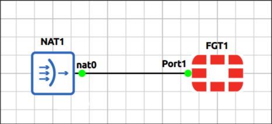
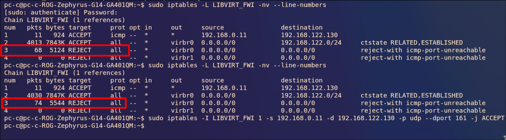
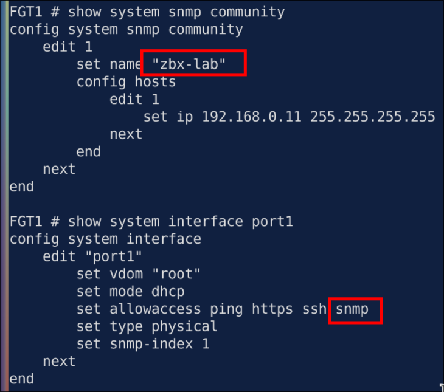
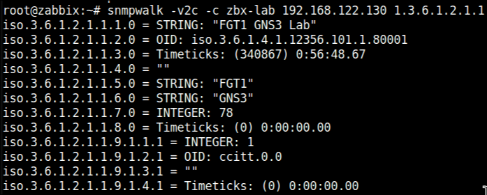
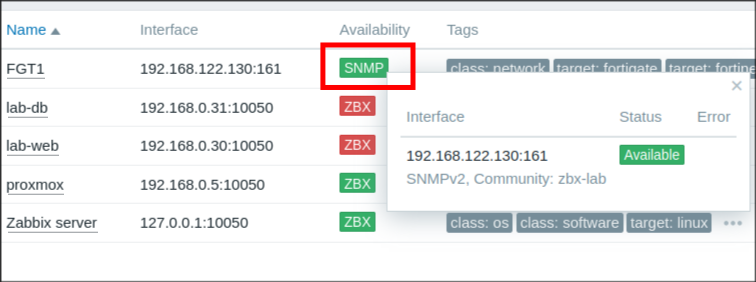
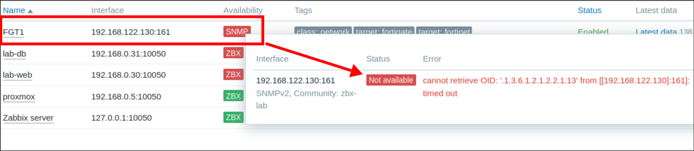
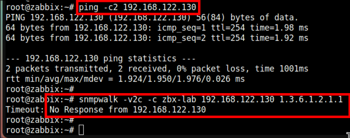
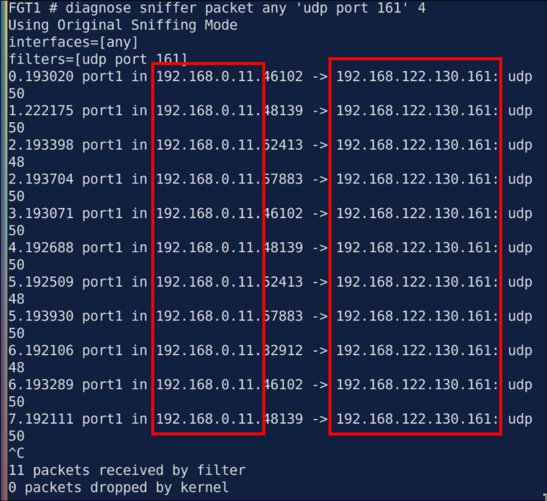
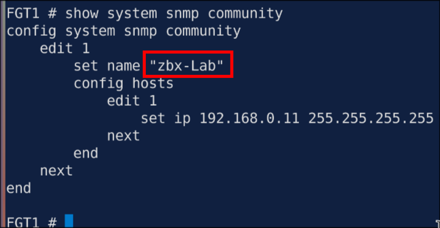
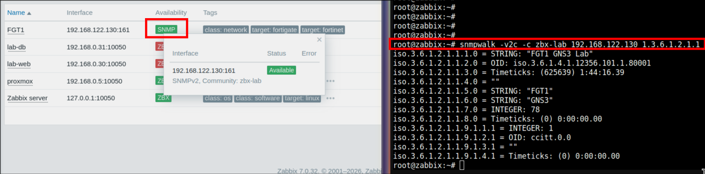

# Lab 2.1: FortiGate SNMP v2c Host and SNMP-Only Fault

> **GNS3 Project:** [`Zabbix Module 2 - SNMP Monitoring | Lab 1 - FortiGate SNMP v2c Host.gns3`](./Zabbix%20Module%202%20-%20SNMP%20Monitoring%20%7C%20Lab%201%20-%20FortiGate%20SNMP%20v2c%20Host.gns3)
> **Platform:** GNS3 3.1 · FortiGate VM FortiOS `8.0.1` (FGT1) · Zabbix server 7.0 (Proxmox LXC) · template **FortiGate by SNMP**
> **Key takeaway:** Ping working proves nothing about SNMP. A wrong v2c community gets **no reply at all**, so in Zabbix it looks exactly like a firewall drop (timeout). A sniffer on the device splits "never arrived" from "arrived and ignored".

---

## Topology & Addressing

| Device | Interface | Address | Role |
| :--- | :--- | :--- | :--- |
| **Zabbix server** | `eth0` | 192.168.0.11/24 | SNMP poller (Proxmox LXC) |
| **Lab PC** | `wlp2s0` | 192.168.0.105/24 | Runs GNS3; routes between LAN and `virbr0` |
| **Lab PC** | `virbr0` | 192.168.122.1/24 | GNS3 NAT node (libvirt `default` network) |
| **FGT1** | `port1` | 192.168.122.130/24 (DHCP) | SNMP agent |

The lab PC is on Wi-Fi, so a bridged Cloud node doesn't work (the AP drops frames from extra MAC addresses). FGT1 sits behind the GNS3 **NAT** node instead, and the Zabbix server reaches it by routing through the PC.

---

## Lab Setup

### Task 1: FGT1 Port1 (DHCP from the NAT node)

~~~
config system interface
    edit port1
        set mode dhcp
        set allowaccess ping https ssh
    next
end
get system interface physical port1
~~~

FGT1 gets `192.168.122.130` from the NAT node.

### Task 2: Path from the Zabbix Server to FGT1

1. **Static route on the Zabbix server.** .11 has no route to `192.168.122.0/24`, so send it to the lab PC:
   ~~~bash
   ip route add 192.168.122.0/24 via 192.168.0.105
   ip route get 192.168.122.130
   ~~~

2. **Allow inbound through libvirt's firewall on the lab PC.** After the route, ping from .11 returned `Destination Port Unreachable` **from 192.168.0.105**. libvirt's NAT network only lets RELATED/ESTABLISHED traffic into `virbr0` and REJECTs anything NEW:
   ~~~
   -A LIBVIRT_FWI -d 192.168.122.0/24 -o virbr0 -m conntrack --ctstate RELATED,ESTABLISHED -j ACCEPT
   -A LIBVIRT_FWI -o virbr0 -j REJECT --reject-with icmp-port-unreachable
   ~~~
   FGT1 → Zabbix works because FGT1 opens the connection and the reply is ESTABLISHED. Zabbix → FGT1 is NEW, so it hits the REJECT. SNMP polling always starts from Zabbix.

   Least-privilege fix: only ICMP and UDP 161, only from .11, only to FGT1, inserted above the REJECT:
   ~~~bash
   sudo iptables -I LIBVIRT_FWI 1 -s 192.168.0.11 -d 192.168.122.130 -p icmp -j ACCEPT
   sudo iptables -I LIBVIRT_FWI 1 -s 192.168.0.11 -d 192.168.122.130 -p udp --dport 161 -j ACCEPT
   sudo iptables -L LIBVIRT_FWI -nv --line-numbers
   ~~~

> At first I only had the ICMP rule: ping worked but `snmpwalk` got no response. The packet counters (`-nv`) showed the SNMP packets hitting the REJECT line.

> The route and the iptables rules are **not persistent**. They're lost when .11 or the lab PC reboots, or when libvirt restarts.

### Task 3: SNMP on FGT1

FortiGate SNMP needs three pieces, and all three are needed:

| Piece | Purpose |
| :--- | :--- |
| `system snmp sysinfo` | Turns the SNMP agent on |
| `system snmp community` | v2c community + hosts allowed to query |
| `allowaccess snmp` | Lets SNMP in on the interface |

~~~
config system snmp sysinfo
    set status enable
    set description "FGT1 GNS3 lab"
    set location "GNS3"
end

config system snmp community
    edit 1
        set name "zbx-lab"
        config hosts
            edit 1
                set ip 192.168.0.11 255.255.255.255
            next
        end
    next
end

config system interface
    edit port1
        append allowaccess snmp
    next
end
~~~

- The community name is case-sensitive.
- The hosts entry is .11's real IP. The lab PC doesn't NAT inbound traffic, so FGT1 sees the requests coming from `192.168.0.11`.
- `append` adds to the list. `set allowaccess snmp` would replace it and drop ping/https/ssh.

### Task 4: CLI Baseline from the Zabbix Server

Prove SNMP works from the poller before touching the Zabbix UI (`apt install snmp` if `snmpwalk` is missing):
~~~bash
snmpwalk -v2c -c zbx-lab 192.168.122.130 1.3.6.1.2.1.1
~~~

`1.3.6.1.2.1.1` is the **system** branch (sysDescr, sysUpTime, sysName, sysLocation). If this works and Zabbix later shows SNMP red, the fault is in the Zabbix config. If this fails too, it's the network or the device.

### Task 5: Zabbix Host

**Data collection → Hosts → Create host:**

| Field | Value |
| :--- | :--- |
| Host name | `FGT1` (label only, not the community) |
| Templates | **FortiGate by SNMP** |
| Host groups | `Network devices` |
| Interface | SNMP · `192.168.122.130` · port `161` · SNMPv2 · community `zbx-lab` |

After about a minute the **SNMP** availability icon turns green and Latest data fills in.

---

## Fault-Injection (Break-It)

### Symptom
FGT1's **SNMP** availability icon in Zabbix turned red. The firewall is up and nothing was changed in Zabbix.

### Diagnosis

1. **Is the path up?** Ping from the Zabbix server works, but `snmpwalk` with the community Zabbix uses times out. So the CLI fails too, and the fault is on the network or the device, not in Zabbix.
   ~~~bash
   ping -c3 192.168.122.130
   snmpwalk -v2c -c zbx-lab 192.168.122.130 1.3.6.1.2.1.1
   ~~~
   

2. **Do the requests reach FGT1?** The sniffer shows requests coming **in** from `192.168.0.11` and nothing going **out**. Network ruled out: FGT1 is receiving and ignoring them.
   ~~~
   diagnose sniffer packet any 'udp port 161' 4
   ~~~
   

3. **Why is it ignoring them?** The community on FGT1 is `zbx-Lab`, but Zabbix sends `zbx-lab`. The community is case-sensitive, and v2c sends no error back for a wrong one.
   ~~~
   show system snmp community
   ~~~
   

> **Same symptom, three causes:** wrong community, Zabbix IP missing from the community `hosts`, or `snmp` missing from `allowaccess`. All three give a timeout, and all three show "request in, no reply" in the sniffer. Once the sniffer points at the device, check all three in the config.

### Fix
~~~
config system snmp community
    edit 1
        set name "zbx-lab"
    next
end
~~~

### Verification

| Test | Expected |
| :--- | :---: |
| `snmpwalk -v2c -c zbx-lab 192.168.122.130 1.3.6.1.2.1.1` (from .11) | sysDescr, sysUpTime, sysName returned |
| `diagnose sniffer packet any 'udp port 161' 4` | `in` and `out` lines for each request |
| Zabbix → Hosts → FGT1 | SNMP icon green |
| Monitoring → Latest data (FGT1) | Uptime and interface values updating |

---

## Troubleshooting Toolbox

| Command | What it shows |
| :--- | :--- |
| `snmpwalk -v2c -c <community> <ip> 1.3.6.1.2.1.1` | CLI baseline from the poller. Works but Zabbix red = Zabbix config; fails = network/device |
| `diagnose sniffer packet any 'udp port 161' 4` | Do requests arrive, and does FGT1 answer? |
| `show system snmp community` | Community name and allowed hosts |
| `show system interface port1` | `allowaccess` includes `snmp` |
| `iptables -L LIBVIRT_FWI -nv --line-numbers` (lab PC) | Which rule the packets hit (counters) |
| `ip route get 192.168.122.130` (Zabbix server) | Route to the GNS3 subnet |
