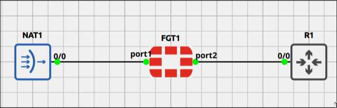
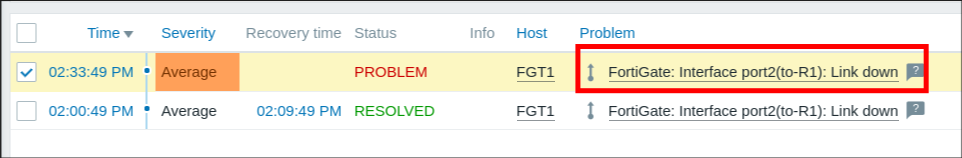
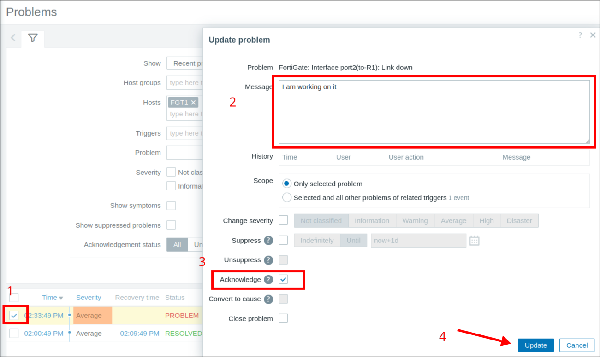
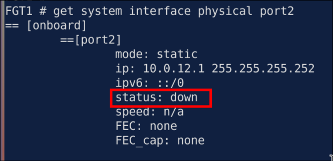
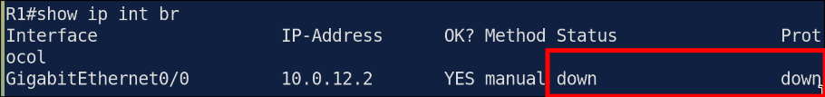
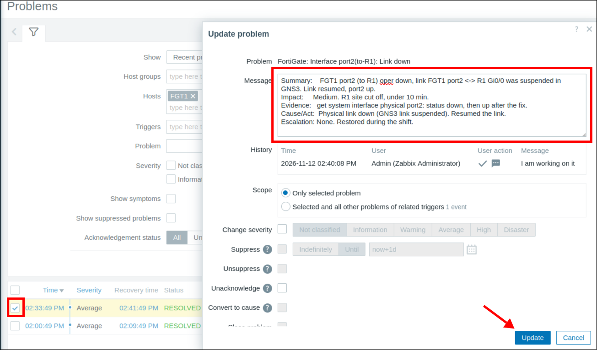
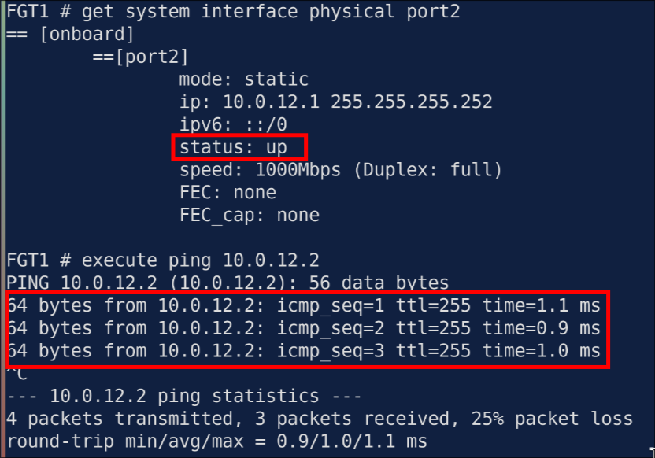
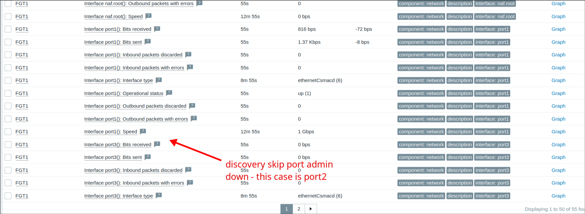

# Lab 2.2: Interface Link Down (FortiGate port2)

> **GNS3 Project:** [`Zabbix Module 2 - SNMP Monitoring | Lab 2 - Interface Link Down (FortiGate port2).gns3`](./Zabbix%20Module%202%20-%20SNMP%20Monitoring%20%7C%20Lab%202%20-%20Interface%20Link%20Down%20%28FortiGate%20port2%29.gns3)
> **Platform:** GNS3 3.1 · FortiGate VM FortiOS `8.0.1` (FGT1) · Cisco IOSv 15.9 (R1) · Zabbix server 7.0 · template **FortiGate by SNMP**
> **Key takeaway:** Admin **up** + oper **down** = physical (cable, peer, optic). Admin **down** = shut in the config, and Zabbix stays **silent** because discovery drops admin-down ports. "It's a virtual lab, so L1 is fine" is an assumption: in GNS3 a suspended link *is* a pulled cable.

---

## Topology & Addressing

| Device | Interface | Address | Role |
| :--- | :--- | :--- | :--- |
| **Zabbix server** | `eth0` | 192.168.0.11/24 | SNMP poller (Proxmox LXC) |
| **Lab PC** | `virbr0` | 192.168.122.1/24 | GNS3 NAT node, routes LAN ↔ GNS3 |
| **FGT1** | `port1` | 192.168.122.130/24 (static) | SNMP agent, polled by Zabbix |
| **FGT1** | `port2` | 10.0.12.1/30 | Link to the R1 site |
| **R1** | `Gi0/0` | 10.0.12.2/30 | Remote site router |

Same path from Zabbix to FGT1 as [Lab 2.1](../Lab%201%20%E2%80%93%20FortiGate%20SNMP%20v2c%20Host/README.md) (static route on .11 + libvirt iptables ACCEPTs). port1 is static here so the IP matches the Zabbix host and the iptables rules.

---

## Fault-Injection (Break-It)

### Symptom
Zabbix raised a **Link down** problem on FGT1 for `port2`. Users at the R1 site reported they were cut off.

### Diagnosis

1. **Acknowledge first.** Before touching anything: Problems → Update → Acknowledge, with a short message. That shows the rest of the NOC that someone owns it.

   

2. **Admin or oper down?** On FGT1, `port2` shows `status: down`, but the config has no `set status down`. So it's administratively up and operationally down.
   ~~~
   get system interface physical port2
   show system interface port2
   ~~~
   

3. **Can FGT1 reach the peer?** 100% loss to R1.
   ~~~
   execute ping 10.0.12.2
   ~~~

4. **Peer side.** R1 `Gi0/0` is `down/down`, not `administratively down`. Neither end is shut, so the problem is the link between them. In GNS3 the FGT1–R1 link was **suspended**.
   ~~~
   show ip interface brief
   ~~~
   

> At first I called it "admin down". It wasn't: admin down shows as `set status down` on FortiOS or `administratively down` on IOS. Here both ends were admin up with only oper down, which points at L1.

### Fix
Resumed the suspended FGT1 port2 ↔ R1 Gi0/0 link in GNS3 (= reconnecting the cable).

### Ticket (posted as the Zabbix problem update message)

~~~
Summary:    FGT1 port2 (to R1) oper down, link FGT1 port2 <-> R1 Gi0/0 was suspended in GNS3. Link resumed, port2 up.
Impact:     Medium. R1 site cut off, under 10 min.
Evidence:   get system interface physical port2: status down, then up after the fix.
Cause/Act:  Physical link down (GNS3 link suspended). Resumed the link.
Escalation: None. Restored during the shift.
~~~

### Verification

| Test | Expected |
| :--- | :---: |
| `get system interface physical port2` | `status: up` |
| `execute ping 10.0.12.2` | Replies (first one may drop for ARP) |
| R1 `show ip interface brief` | `Gi0/0 up/up` |
| Zabbix → Problems (FGT1) | Link down problem **RESOLVED**, ack + message in its history |

---

## Fault 2: Port Shut on FGT1 (Silent in Zabbix)

### Symptom
The R1 site was cut off again, but this time **no problem showed up in Zabbix**. In Latest data for FGT1, port1 and port3 were listed and **port2 was gone**.

### Diagnosis

1. **Why is port2 missing?** port3 has no cable at all and is still listed, so "down" alone doesn't remove a port. The interface discovery rule filters out ports whose **admin status is down** (`{$NET.IF.IFADMINSTATUS.NOT_MATCHES}`, default `^2$`). Zabbix treats an admin-down port as shut on purpose, so the items are dropped and there is nothing to trigger on.

2. **Admin or physical?** `get system interface physical port2` shows `status: down`, the same as Fault 1, so it can't tell the two apart. The GNS3 link was up (not suspended), and the config showed the cause:
   ~~~
   show system interface port2
       set status down
   ~~~

> I first called this an L3 problem. It's not: admin down is the port switched off in the config. L3 would be a wrong IP or a missing route, and then the link stays up and only pings fail. A wrong IP never takes a port down.

### Fix
~~~
config system interface
    edit port2
        set status up
    next
end
~~~

### Verification

| Test | Expected |
| :--- | :---: |
| `get system interface physical port2` | `status: up` |
| `execute ping 10.0.12.2` | Replies |
| Zabbix → Latest data (FGT1) | port2 discovered again. **Execute now** on its operational status item shows **up** |

### Fault 1 vs Fault 2

| | Fault 1 (link suspended) | Fault 2 (`set status down`) |
| :--- | :---: | :---: |
| Admin / oper status | up / down | down / down |
| Zabbix problem | **Link down** fires | Nothing. port2 drops out of discovery |
| Peer side (R1 Gi0/0) | `down/down` | `up/up` (GNS3 doesn't pass carrier loss) |
| How you find out | Zabbix alert | User complaint |

---

## Troubleshooting Toolbox

| Command | What it shows |
| :--- | :--- |
| Zabbix → Monitoring → Problems → **Update** | Acknowledge, add a message, change severity, close |
| `get system interface physical port2` | Oper status and speed on FortiOS |
| `show system interface port2` | Config: `set status down` here = admin down |
| `execute ping 10.0.12.2` | Reachability to the peer |
| R1 `show ip interface brief` | `administratively down` vs `down/down` on the peer |
